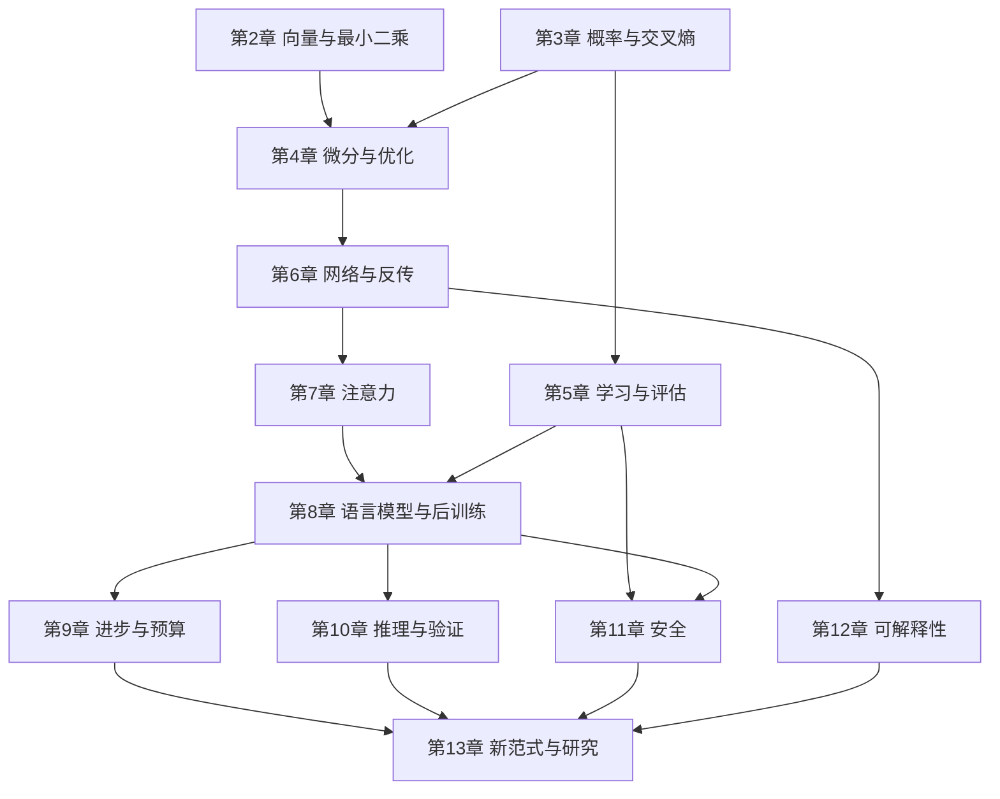

# 从自学到研究的依赖路线

入口假定会高中代数、单变量导数和基本 Python。积分基本定理、谱定理和欧氏空间完备性在正文声明为调用工具；本书没有证明实数完备性或整套分析学。全部研究主题均依赖可检验的任务定义。

|阶段|正文|实际练习/实验|出口检查|
|---|---|---|---|
|基础|1–4|ridge|能复算正规方程、KL、交叉熵与链式法则；解释病态与步长|
|学习系统|5–7|mlp、spurious|能画数据划分、手算网络梯度、验证掩码和注意力维度|
|语言模型|8–10|language_model、preference、search_verifier|能对齐目标，区分生成覆盖与选择准确率，给出训练/推理预算|
|研究入口|11–13|injection、研究方案|能定义威胁模型和干预，冻结基线与评价，写有条件的结论|

阶段按能力推进，不强迫按周完成。建议每节完成“复算一条推导—运行实验—先预测再改一个变量—解释差异”。每章练习有答案，第一次尝试时遮住答案。

后续补学可按需进入 [MML](https://mml-book.github.io/)、[Boyd](https://web.stanford.edu/~boyd/cvxbook/)、[D2L](https://d2l.ai/) 与 [CS336 2026](https://cs336.stanford.edu/)。完整 CS336 作业要求已有深度学习与系统经验；本项目 CPU 实验不是完成原课的声明。
